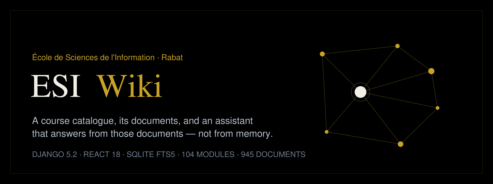

# ESI Wiki — École de Sciences de l'Information, Rabat



Most course knowledge lives in the wrong place: scattered across Drive folders, group chats and
half-named PDFs, and unreachable exactly when someone needs it. This project puts that material behind
a real catalogue — **104 modules, 945 documents, S1-S5** — and then makes a question answerable by an
assistant that reads the school's own files instead of guessing about them.

Getting there is the engineering part: a crawler, a resumable Drive mirror, text extraction, a BM25
index, and a four-tier answer pipeline where **a model is never trusted with a number or a rule**. Free
models invent catalogue figures; the database does not.

## What is in it

| | |
|---|---|
| Catalogue | **104 modules / 945 documents** — 29 modules from the S1-S2 files, 75 from the EsiHub mirror (S3-S5) |
| Coverage | S1-S5. S6 is the graduation-project year: 45 reports, no modules, here or on EsiHub |
| Programmes | Tronc commun in S1-S2, then ICSD, IDC, IIN, ISITD, ISSIC |
| Text the assistant can read | **1 403 documents** (1 304 with extractable text), **19 646 passages**, SQLite **FTS5** ranked by BM25 |
| Document mirror on disk | **1.98 Go** of PDF/DOCX/PPTX pulled from EsiHub's Drive folders, in `corpus/` (not versioned) |
| External index | 374 EsiHub modules and 554 Drive links, surfaced at `/esihub` |
| Media | 33 Wikimedia Commons photographs under free licences, authors credited — generic campus illustrations, not the ESI campus, and labelled as such on `/campus` |

## Stack

Django 5.2 + DRF + SQLite (timezone `Africa/Casablanca`) · React 18 + Vite 5.4 + Tailwind 3.4 ·
PyInstaller + waitress for the standalone Windows build. One Django process serves the API, the
documents, the Vite bundle, the photos and the SPA catch-all — no Postgres, no Redis, no build service
needed to run or demo it.

## Run it

```bash
python -m venv backend-venv
backend-venv\Scripts\activate
pip install -r backend\requirements.txt
copy .env.example .env                    # set DJANGO_SECRET_KEY

cd backend
python manage.py migrate
python manage.py seed_catalog             # S1-S2 from courses/
python manage.py seed_content             # programmes, FAQ, news
python manage.py seed_esihub              # external catalogue, offline from tools/esihub-catalog.json
python manage.py seed_mirror              # S3-S5 from the mirrored corpus
python manage.py runserver 8000
```

```bash
cd frontend && npm install
npm run dev                               # http://localhost:5173, /api proxied to :8000
npm run build                             # http://localhost:8000 then serves the built site
```

Django serves `frontend/dist/`, not the sources — rebuild after any frontend edit. The seeds never
collide: each rewrites only the rows it owns (`origin="depot"` or `origin="esihub"`), so any order works
and both are replayable after a re-fetch. `python manage.py index_corpus` reads `corpus/` and
`courses/` together and skips a repo file already mirrored under the same name and byte size.

Neither document folder is versioned: `courses/` (the S1-S2 files) and `corpus/` (the mirror) belong to
the school and to the students who assembled them. A clone therefore starts with the catalogue, the
code and the tools; the text layers stay quiet until the files are supplied locally.

## The assistant

Four tiers, tried in that order; every reply carries `mode`, so the UI can name the tier that answered.

| | `mode` | What it is |
|---|---|---|
| 1 | `local` | SQLite tables — modules, counts, programmes, grade bands, FAQ rules |
| 2 | `corpus` | FTS5 over the indexed documents — hands verified passages to tiers 3-4, and quotes them directly when no model answers |
| 3 | `provider` | Gemini → NVIDIA → OpenRouter → OpenAI, each with its own key and slugs |
| 4 | `keyless` | anonymous endpoint, no account, best-effort |

- **Numbers and rules never come from a model.** Tier 1 short-circuits on a match: a free model asked
  about the catalogue answered "114 modules / 337 documents" where the tables hold 104 and 945, and
  "Assez Bien" for 17/20. Counting is done by the ORM, and the prompt forbids the model from counting.
- **Tier 2 only answers under its own name when nothing else can**, and then quotes the file with its
  name, programme, semester and module code. Retrieval is gated: a passage is used only if it covers two
  question words, one rare enough across the corpus to identify the subject — otherwise an OR `MATCH`
  always returns *something*, and the first file found would read as a real answer.
- **Keys stay server-side** and are only ever sent to the host that issued them — there is no shared
  model or base-URL setting to get wrong, and a key of the wrong shape is rejected before it leaves.
- **A dead tier says so.** Failures are collected and returned as `note`, rendered under the answer, so
  a configured-but-revoked key never looks like a working model. Free tiers fail independently (quota,
  503s, slugs flipping paid), which is why there are four providers instead of one dependable key.
- OpenAI is last because it bills. An empty key line skips that provider silently.

## Windows build

```powershell
pip install pyinstaller waitress
.\packaging\build-sample.ps1              # dist\ESI-Wiki-Sample\ESI-Wiki.exe          — keys embedded
.\packaging\build-sample.ps1 -Keyless     # dist\ESI-Wiki-Sample-Keyless\ESI-Wiki.exe  — bring your own key
```

Two flavours from one script, for two audiences. The **keyed** build has the owner's provider keys
compiled into the binary (`keys_embed.py` → `embedded_keys.py`, added as a hidden import): nothing for
the recipient to configure. That build is handed over in person or kept in private storage — never
committed, never released. The **-Keyless** build carries no key at all and ships `.env.example`: it
reads the recipient's own key from the environment or from a `.env` beside the `.exe`, and it is what
GitHub Releases publishes (`v1.5`).

Both flavours ship without the document folders and with the indexed text stripped from the delivered
database (`packaging/strip-corpus.py`). Mirrored modules stay in the catalogue and open their original
Drive file (`drive_id`); the S1-S2 files open from `/courses/` if that folder was copied beside the
`.exe`. Onedir, ~99 MB unpacked; the launcher serves `http://127.0.0.1:8013` and keeps its console
window open. Delete the `db.sqlite3` and `frontend/` copies the `.exe` writes beside itself before zipping.

## API

| Endpoint | |
|---|---|
| `GET /api/stats/` | module, document, programme, semester, report and size counters |
| `GET /api/majors/` · `GET /api/semesters/` | programmes, S1-S5 |
| `GET /api/modules/?block=&semester=&branch=&search=` | catalogue list (unpaginated) |
| `GET /api/modules/<slug>/` | one module, its documents, `hub_references` across programmes |
| `GET /api/faqs/` | regulations grouped by category |
| `GET /api/hub/courses/` · `/hub/reports/` · `/hub/meta/` | the external EsiHub catalogue |
| `GET /api/contact-info/` | address and phone shown by `/contact` and the footer |
| `POST /api/chat/` | the assistant — history as JSON, never a key |
| `POST /api/contact/` | message form (subject required, body ≥ 20 characters) |

```bash
curl -s -X POST http://localhost:8000/api/chat/ -H "Content-Type: application/json" -d "{\"messages\":[{\"role\":\"user\",\"content\":\"Quelle mention pour 17/20 ?\"}]}"
```

Pages: `/` · `/programmes` · `/programmes/:slug` · `/esihub` · `/campus` · `/faq` · `/a-propos` ·
`/contact` · `/assistant`.

## Where the data comes from

`tools/fetch-esihub.mjs` crawls esihub.net into `tools/esihub-catalog.json` (versioned, so `seed_esihub`
needs no network). `tools/esihub_drive.py` enumerates the Google Drive folders behind it and
`tools/esihub_fetch.py` mirrors files into `corpus/<SEM>/<BRANCH>/<CODE>/<KIND>/` — resumable,
`manifest.jsonl` being the record of what was fetched. `catalog/corpus.py` extracts text, chunks it by
paragraph and maintains the FTS5 table. Three quirks of the source are handled in code rather than
passed on: `data-semester` is 0-indexed while the tabs read S1-S5; the same course appears under two
graduation years with different documents, so the uniqueness key carries `year`; and `4.2` exists in
ISSIC *and* IDC with different content, so `unique_together` is `(semester, branch, code)`.

## Security

- `.env`, `logs/`, `corpus/`, `courses/`, `build/`, `dist/` and `packaging/embedded_keys.py` are
  gitignored. The staged tree is grepped for the real key values — not just their prefixes — before
  every commit, and the built folder is scanned byte by byte before anything is zipped.
- A billable key never enters an embedded build, a zip or a Release; `keys_embed.py` refuses at compile
  time if one is configured.
- Google issues two key shapes (`AIza…` and `AQ.…`), and both are accepted — coding only one would
  reject working keys. `sk-…` is broad enough to swallow an OpenRouter token, so OpenAI's entry
  explicitly rejects `sk-or-…`.
- Contact details are read from `/api/contact-info/`, so an address change needs no rebuild and a phone
  number stays unpublished unless `WIKI_CONTACT_PHONE` is set.

## Layout

```
backend/     config · catalog · core · aichat · management/commands
frontend/    src/pages · src/components · src/lib · dist (built bundle, served by Django)
tools/       fetch-esihub.mjs · esihub-catalog.json · esihub_drive.py · esihub_fetch.py
packaging/   launcher.py · keys_embed.py · strip-corpus.py · esi-wiki-sample.spec · build-sample.ps1
docs/        banner.svg · banner.png · architecture.svg
corpus/      EsiHub mirror + manifest, not versioned   -> /polycopies/
courses/     S1-S2 documents, not versioned            -> /courses/
CHANGELOG.md change history by release
```

`docs/architecture.svg` maps the request path: browser → Django → the four tiers.

## Known limits

- ~90 mirrored documents are scanned images and yield no text; an OCR pass is measured and ready but
  not run by default.
- Legacy `.ppt` / `.doc` / `.xlsx` files are mirrored but not indexed — text extraction covers zip/OOXML.
- Seven Drive folders arrive undivided, one per programme and semester; their files form a single
  "Divers" module instead of being guessed apart from scanned filenames.
- MSICS is in the EsiHub index but nothing was mirrored for it; it stays on `/esihub`.
- Tier 4 is disappearing: the anonymous providers are retiring their text APIs one by one.
- A question outside the catalogue and outside the documents is answered by a model or not at all — the
  assistant says which, rather than inventing.

---

The documents are the part that cannot be published here, so they go person to person while the code
stays open. Write to **mohamed-amine.chafik@esi.ac.ma** for a copy of the S1-S2 files, for the build
that runs the assistant with its keys already configured, for usage rights, or for a correction.
